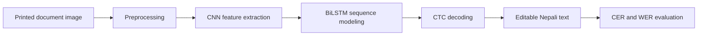

# Akshar AI

**Making printed Nepali text searchable, editable, and easier to preserve.**

Akshar AI is a proposed deep-learning-based Optical Character Recognition (OCR)
system for recognizing printed Nepali (Devanagari) text in images and converting
it into digital text. It focuses on the digitization of books, newspapers,
academic materials, and other printed documents that are not yet available in
searchable formats.

> **Project status:** Research and development. The model, dataset, and
> implementation are under development.

## Why Akshar AI?

Many valuable Nepali publications remain available only as paper documents or
scanned images. Nepali OCR is challenging because of complex character shapes,
vowel modifiers, conjuncts, font variation, and the skew, noise, and uneven
illumination often found in scans. Akshar AI aims to address these challenges
with a recognition pipeline trained for printed Nepali text.

## Proposed approach

The initial system is designed to recognize text lines from document images
using a Convolutional Neural Network (CNN), a Bidirectional Long Short-Term
Memory network (BiLSTM), and Connectionist Temporal Classification (CTC).
CTC enables sequence training without requiring each character to be segmented
and labeled individually.

### Planned workflow

1. **Prepare the dataset** — collect and transcribe printed Nepali text images,
   then split the data into training, validation, and test sets.
2. **Preprocess images** — prepare image regions for recognition, including
   handling image size, skew, noise, and illumination where needed.
3. **Train the model** — learn visual features with a CNN, model text sequences
   with a BiLSTM, and use CTC for end-to-end alignment and decoding.
4. **Evaluate performance** — measure Character Error Rate (CER) and Word Error
   Rate (WER) on held-out data, and inspect common recognition errors.
5. **Improve and expand** — use evaluation results to refine the data and model
   for a wider range of printed-document quality and fonts.

## Evaluation

Akshar AI will use standard OCR error metrics:

- **Character Error Rate (CER):** character-level edit distance divided by the
  number of characters in the reference transcription.
- **Word Error Rate (WER):** word-level edit distance divided by the number of
  words in the reference transcription.

Lower CER and WER indicate closer agreement with the reference text. Evaluation
will use consistent text normalization and clearly defined test data so that
results are comparable.

## Scope

The initial focus is **printed Nepali text**. Handwriting recognition,
document-layout understanding, and support for other scripts are outside the
initial scope and may be considered later.

## Current availability

This repository currently documents the project proposal. Training code,
datasets, pretrained weights, and a user-facing application are not yet
available. They will be documented here as they are developed.

## Contributing

Contributions to dataset preparation, Nepali text normalization, OCR research,
and implementation are welcome. Please open an issue to discuss a substantial
change before starting work.

## Keywords

Optical Character Recognition · Nepali script · Devanagari · Deep Learning ·
CNN · BiLSTM · CTC · CER · WER
